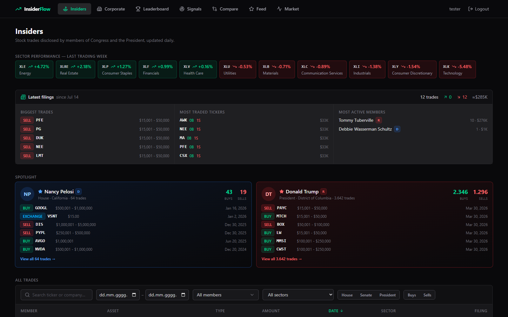
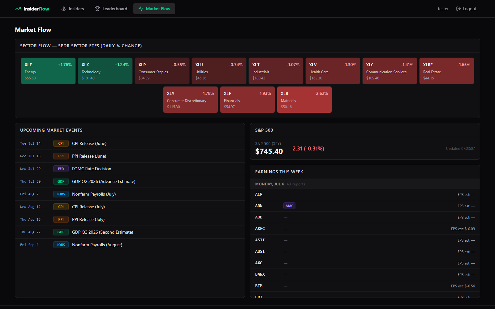
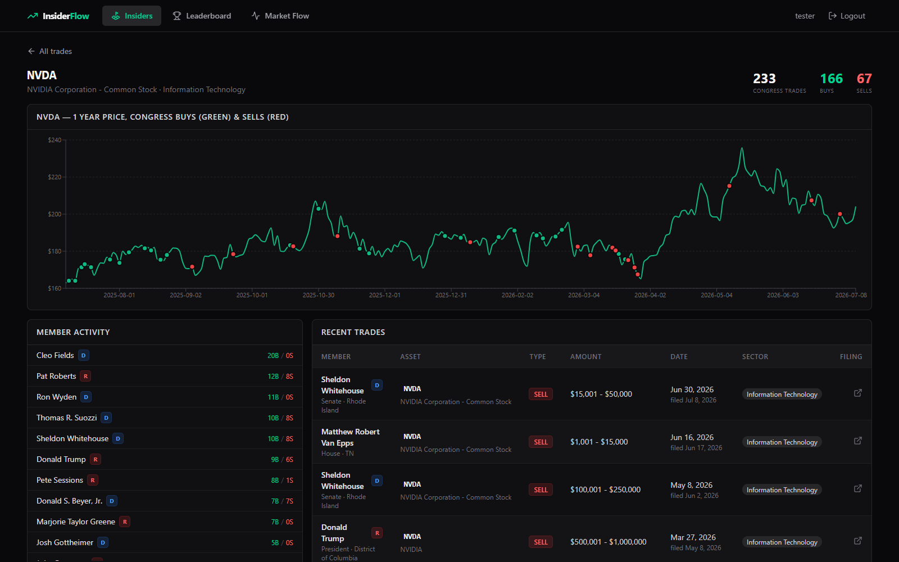
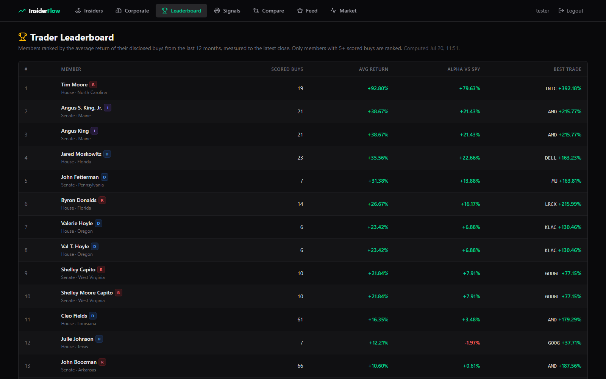
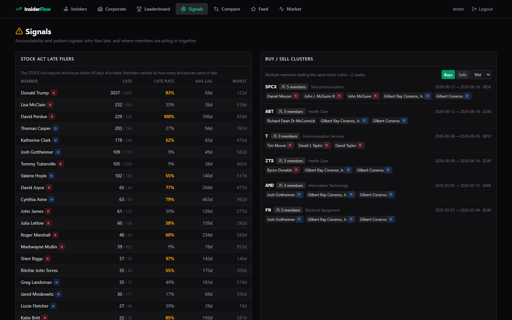
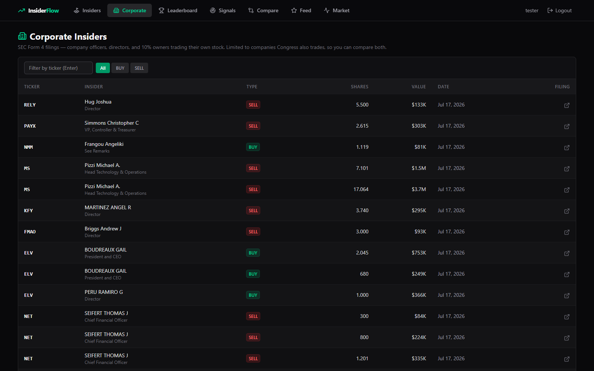
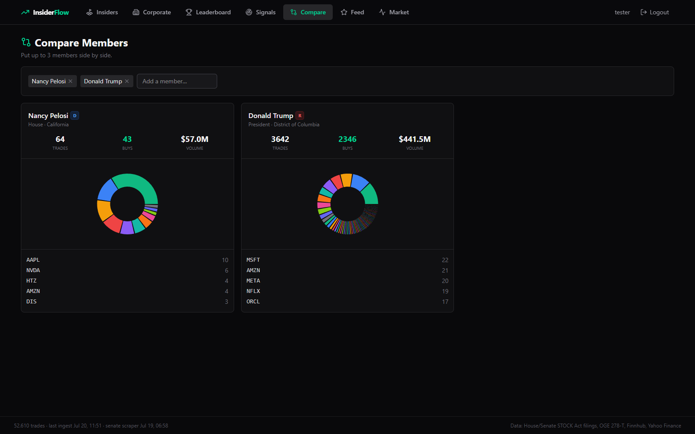

# InsiderFlow — Congress Trading & Market Flow

A full-stack web app for tracking US Congress (and presidential) stock trades from STOCK Act / OGE filings, plus daily market flow, in a dense dark-themed data-table style.

- **Insiders tab** — every House + Senate + presidential stock transaction with party badges, searchable and filterable (member, sector, chamber, buy/sell, ticker/company search, date range), sortable columns, hot-ticker highlighting, weekly sector strip, a Pelosi/Trump spotlight, and a **daily digest** of the latest filings. Trades carry accountability flags: **LATE** (STOCK Act >45-day disclosure), **COMMITTEE** (member's committee oversees the sector), **EARNINGS** (traded shortly before a report). Member, sector, and ticker detail pages (the ticker page shows a 1-year price chart with congress buy/sell markers).
- **Corporate tab** — SEC Form 4 filings: company officers, directors, and 10% owners trading their own stock, limited to companies Congress also trades so you can compare both on one ticker.
- **Leaderboard tab** — members ranked by average return of their last-12-month buys, plus **alpha vs the S&P 500** (return in excess of the market).
- **Signals tab** — STOCK Act late-filers ranking + buy/sell clusters (multiple members piling into the same ticker within ~2 weeks).
- **Compare tab** — up to 3 members side-by-side (volume, sectors, top tickers).
- **Feed tab** — trades by the members and tickers you follow (★ to add).
- **Market Flow tab** — SPDR sector ETF heatmap, macro events (FOMC / CPI / PPI / NFP / GDP), S&P 500 strip, weekly earnings.
- **Data freshness** — footer shows per-source freshness; banners warn when the senate scraper goes stale or a new presidential 278-T filing is detected on OGE.

## Stack

| Layer    | Tech |
|----------|------|
| Frontend | Vite + React 18 + TypeScript, Tailwind CSS, React Router, Axios, Recharts |
| Backend  | Java 17+, Spring Boot 3 (Web, Security, Data MongoDB, Scheduling), Maven |
| Database | MongoDB |
| Auth     | JWT (jjwt) + BCrypt |

## Prerequisites

- **Java 17+** (`java -version`)
- **Node 18+** (`node -v`)
- **MongoDB** running on `localhost:27017` (or set `MONGODB_URI`). Easiest way:
  ```
  docker run -d --name insiderflow-mongo -p 27017:27017 -v insiderflow-mongo-data:/data/db mongo:7
  ```
- **Finnhub API key** (free) — register at [finnhub.io](https://finnhub.io/register), copy your key, and set it before starting the backend:
  ```powershell
  $env:FINNHUB_API_KEY = "your_key_here"     # PowerShell
  ```
  ```bash
  export FINNHUB_API_KEY=your_key_here       # bash
  ```
  Without a key the app still works — congress trades ingest fine — but sector-ETF quotes, the S&P strip, earnings, and Finnhub sector resolution for unseeded tickers are disabled.

Maven does not need to be installed — the project ships with the Maven wrapper (`mvnw`).

## Run

**Everything at once (Docker Compose):**

```
docker compose up -d        # Mongo + backend + frontend
```

Or run the pieces individually:

**Backend** (port 8080):

```
cd backend
mvnw spring-boot:run          # Windows: .\mvnw.cmd spring-boot:run
```

**Frontend** (port 5173):

```
cd frontend
npm install
npm run dev
```

Open http://localhost:5173, register an account (min 8 chars, 1 number, 1 uppercase), and you're in.

## Data ingestion (first run)

On startup the backend automatically ingests all Senate + House STOCK Act transactions from the community-maintained S3 mirrors:

- Senate: `senate-stock-watcher-data.s3-us-west-2.amazonaws.com/aggregate/all_transactions.json`
- House: `house-stock-watcher-data.s3-us-west-2.amazonaws.com/data/all_transactions.json`

If an S3 URL is dead it falls back to GitHub mirror repos (`timothycarambat/senate-stock-watcher-data` for the Senate, `TattooedHead/house-stock-watcher-data` for the House) and logs a warning. **Note:** as of July 2026 both S3 buckets return 403, so in practice the data comes from the GitHub fallbacks — this happens automatically.

**Fresh Senate data (eFD scraper):** the senate mirror stopped updating in March 2021, so current senate trades come from our own scraper of the official [efdsearch.senate.gov](https://efdsearch.senate.gov):

```
cd scripts
npm install
node senate-efd-scraper.js                     # last 7 days of filings
node senate-efd-scraper.js --since 03/16/2021  # full backfill (run once)
```

It writes `data/senate_efd_transactions.json`, which the backend ingests on every ingest run. Requires Google Chrome installed (the site blocks non-browser clients). **Run it daily** (e.g. Windows Task Scheduler at 07:40) so senate data stays current.

**President Trump's trades:** presidents file OGE Form 278-T rather than congressional PTRs, so Trump's 3,642 disclosed transactions (Jan–Mar 2026 filing) are ingested separately from a cleaned mirror of the official OGE filing and appear as chamber "President". Ingestion runs async — the app is usable immediately and trades appear within ~a minute. It re-runs daily at 06:00 UTC. Records are deduplicated on `(member, ticker, transactionDate, amountRange, transactionType)`, so re-running is idempotent.

**Sector mapping** — tickers are mapped to GICS sectors from a ~650-entry static seed (S&P 500 + common ETFs + popular tickers) in `backend/src/main/resources/sectors.json`; unknown tickers are resolved via Finnhub `/stock/profile2` (rate-limited, each ticker looked up once and cached in the `tickers` collection).

**Market data schedules** — sector ETF + SPY quotes refresh every 15 min during US market hours; the weekly earnings calendar refreshes daily at 05:30 UTC; both also refresh on startup. Macro event dates (2026 FOMC/CPI/PPI/NFP/GDP schedule) are seeded from `backend/src/main/resources/market_events.json` — edit that file to extend the calendar.

## Configuration

| Env var | Default | Purpose |
|---------|---------|---------|
| `MONGODB_URI` | `mongodb://localhost:27017/insiderflow` | MongoDB connection |
| `FINNHUB_API_KEY` | *(empty)* | Finnhub free-tier key |
| `JWT_SECRET` | *(random per-process)* | HMAC secret for JWT signing; set for sessions that survive restarts |
| `SEC_ENABLED` | `true` | toggle the SEC Form 4 (corporate insiders) ingestion |
| `SEC_USER_AGENT` | descriptive default | SEC fair-access requires a User-Agent with contact info |

Regenerate the bundled legislators/committee data with `node scripts/gen-legislators.js` (writes `backend/src/main/resources/legislators.json`). After regenerating, drop and re-ingest the `trades` collection so member canonical names stay consistent.

## API overview

All routes except `/api/auth/**` require `Authorization: Bearer <jwt>` (24 h expiry). See [DOCUMENTATION.md](DOCUMENTATION.md#4-api-reference) for the full reference.

- **Auth:** `POST /api/auth/register|login`, `GET /api/auth/me`
- **Trades:** `GET /api/trades` (filters: member, sector, chamber, type, search, from, to, sort) · `/members` · `/sectors` · `/members/{m}/summary` · `/sectors/{s}/timeline` · `/hot-tickers` · `/spotlight` · `/ticker/{t}` · `/leaderboard` · `/digest` · `/late-filers` · `/clusters` · `/compare`
- **Corporate (Form 4):** `GET /api/corporate` · `/corporate/ticker/{t}`
- **Watchlist:** `GET /api/watchlist` · `POST /api/watchlist/toggle` · `GET /api/watchlist/feed`
- **Status/Market:** `GET /api/status` · `/api/market/sector-flow|sector-weekly|events|spx|earnings`

## Screenshots

**Insiders** — weekly sector performance strip, Pelosi/Trump spotlight, live congress trades with hot-ticker highlighting:



**Market Flow** — sector ETF heatmap, macro events calendar, S&P 500 strip, weekly earnings:



**Ticker detail** — 1-year price with congress buy/sell markers, member activity:



**Trader leaderboard** — members ranked by average return and alpha vs the S&P 500:



**Signals** — STOCK Act late-filers ranking and buy/sell clusters:



**Corporate insiders** — SEC Form 4 trades by officers and directors of the same companies Congress trades:



**Compare members** — up to three members side-by-side:


